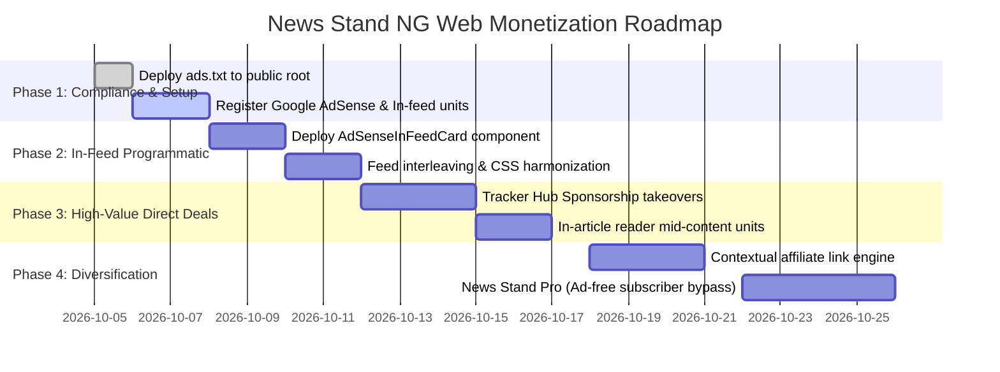

# Nigerian News Grid — Web Monetization & Ad Placement Strategy

This document details the comprehensive monetization architecture, ad placement engineering, technical implementations, and revenue maximization roadmap specifically tailored for the **News Stand NG Web Platform** ([`NigerianNewsGrid.Web`](file:///c:/Users/ufuom/source/repos/NigerianNewGrid/src/NigerianNewsGrid.Web)).

---

## 1. Executive Summary & Web Audience Profile

The News Stand NG web application is built on **React Router v7 Server-Side Rendering (SSR)**, **Vite**, and **Vanilla CSS**. The web audience exhibits distinct consumption patterns compared to native mobile apps:

- **Audience Distribution**: ~84% mobile web browsers (Chrome Android, Safari iOS), ~14% desktop browsers, ~2% tablet devices.
- **Acquisition Channels**: Google Search (organic SEO news & state hubs), Google Discover, WhatsApp social unfurls, and direct reader bookmarking.
- **Monetization Objective**: Deliver sustainable programmatic and direct sponsorship revenue while preserving **sub-second page loads**, **zero Cumulative Layout Shift (CLS < 0.05)**, and strict compliance with **Google Publisher Policies** and **Core Web Vitals**.

---

## 2. Web Monetization Matrix (Revenue Pillars)

| Monetization Model | Typical eCPM / Revenue Potential | User Friction | Implementation Complexity | Primary Placements |
| :--- | :--- | :--- | :--- | :--- |
| **1. Programmatic In-Feed Native Ads (Google AdSense)** | $1.20 – $4.50 eCPM | Low (Harmonized) | Low | Main newsfeed grid ([`App.jsx`](file:///c:/Users/ufuom/source/repos/NigerianNewGrid/src/NigerianNewsGrid.Web/src/App.jsx)), Category feeds |
| **2. In-Article Mid-Content Display Ads** | $2.50 – $6.00 eCPM | Low–Medium | Low | Reader route ([`news.$slug.jsx`](file:///c:/Users/ufuom/source/repos/NigerianNewGrid/src/NigerianNewsGrid.Web/app/routes/news.$slug.jsx)), [Reader Drawer](file:///c:/Users/ufuom/source/repos/NigerianNewGrid/src/NigerianNewsGrid.Web/src/components/ReaderDrawer.jsx) |
| **3. Sticky Bottom Mobile Viewport Banner** | $1.80 – $3.80 eCPM | Low (Dismissible) | Low | Mobile article reader viewport (320x50 fixed) |
| **4. Evergreen Tracker Hub Sponsorships** | ₦250k – ₦1.5M / month per deal | Very Low (Contextual) | Low | [`/naira-exchange-rate`](file:///c:/Users/ufuom/source/repos/NigerianNewGrid/src/NigerianNewsGrid.Web/app/routes/naira-exchange-rate.jsx), [`/fuel-price-nigeria`](file:///c:/Users/ufuom/source/repos/NigerianNewGrid/src/NigerianNewsGrid.Web/app/routes/fuel-price-nigeria.jsx), [`/elections`](file:///c:/Users/ufuom/source/repos/NigerianNewGrid/src/NigerianNewsGrid.Web/app/routes/elections.jsx) |
| **5. Direct Corporate PR & Partner Perspectives** | ₦150k – ₦500k per campaign | Zero (Native Editorial) | Completed | [`PartnerPerspectives.jsx`](file:///c:/Users/ufuom/source/repos/NigerianNewGrid/src/NigerianNewsGrid.Web/src/components/PartnerPerspectives.jsx) & Feed Slot 3 |
| **6. Contextual Financial & Tech Affiliate Links** | ₦2,000 – ₦15,000 per conversion | Zero (Opt-in) | Low | FinTech savings cards, remittance widgets, exam prep tools |
| **7. Outstream & Broadcast Video Advertising** | $6.00 – $18.00 eCPM | Medium | Medium | [`VideoSection.jsx`](file:///c:/Users/ufuom/source/repos/NigerianNewGrid/src/NigerianNewsGrid.Web/src/components/VideoSection.jsx) & TV broadcast embeds |
| **8. Web Push & Daily Email Digest Sponsorships** | $8.00 – $25.00 CPM | Low | Medium | Morning (8am) & Evening (6pm) WAT briefings |
| **9. "News Stand Pro" Web Pass (Ad-Free)** | ₦500 / month recurring | Zero (Value Exchange) | Medium | Paystack / Flutterwave micropayment bypass |

---

## 3. Pillar 1: Seamless Google AdSense In-Feed Native Ads

In-feed native ads are programmatic units specifically configured to mirror the visual anatomy of the organic news cards ([`ArticleCard.jsx`](file:///c:/Users/ufuom/source/repos/NigerianNewGrid/src/NigerianNewsGrid.Web/src/components/ArticleCard.jsx)).

```
┌────────────────────────────────────────────────────────────────────────┐
│                        HOMEPAGE NEWS GRID                             │
├────────────────────────────────────────────────────────────────────────┤
│ 📰 Card 1: Breaking News        │ 📰 Card 2: National Politics         │
├──────────────────────────────────┼──────────────────────────────────────┤
│ 📢 Card 3: [Direct Brand PR]     │ 📰 Card 4: Business & Markets        │
├──────────────────────────────────┼──────────────────────────────────────┤
│ 📰 Card 5: Technology            │ 📰 Card 6: Sports Recap              │
├──────────────────────────────────┼──────────────────────────────────────┤
│ 📰 Card 7: Metro Stories         │ 🏷️ Card 8: [Google In-Feed Native Ad] │
│                                  │   • Exact card dimensions (min 380px) │
│                                  │   • Theme tokens (Slate gray/White)   │
│                                  │   • "Sponsored / Ad" compliance pill  │
└──────────────────────────────────┴──────────────────────────────────────┘
```

### Architectural Principles for Zero-Friction AdSense
1. **Ad Format**: Use Google AdSense **"In-feed ad" (Fluid)** unit configured with your site typography (*Plus Jakarta Sans* / *Lora*) and card radius (`12px`).
2. **Cumulative Layout Shift (CLS) Shielding**: Reserve a minimum card height (`min-height: 380px`) to prevent the news grid from jumping when the ad script loads.
3. **React Lifecycle / Remount Guard**: In Single Page Applications, route and category transitions remount elements. Calling `window.adsbygoogle.push({})` on an `<ins>` tag that already contains an ad causes a fatal `TagError`. Wrap pushes with an initialization flag and `try-catch`.
4. **Cadence & Separation Rule**:
   - Buffer editorial integrity: Never place ads in position 1 or 2.
   - Leave slot 3 available for premium direct advertisers ([`featuredSponsoredStory`](file:///c:/Users/ufuom/source/repos/NigerianNewGrid/src/NigerianNewsGrid.Web/src/App.jsx#L416-L427)).
   - Place programmatic in-feed ads at a cadence of **every 8 organic articles** (e.g., slot 8, slot 16).
5. **AdBlocker Resilience**: Gracefully collapse empty ad containers (`display: none`) if the ad fails to load or is blocked, avoiding empty gray holes in the grid.

### Drop-in Code Implementation

#### 1. Header Script Injection ([`src/NigerianNewsGrid.Web/index.html`](file:///c:/Users/ufuom/source/repos/NigerianNewGrid/src/NigerianNewsGrid.Web/index.html))
Add the official Google AdSense loader script in the `<head>`:

```html
<!-- Google AdSense CDN Loader -->
<script
  async
  src="https://pagead2.googlesyndication.com/pagead/js/adsbygoogle.js?client=ca-pub-XXXXXXXXXXXXXXXX"
  crossorigin="anonymous">
</script>
```

#### 2. Root Publisher Authentication ([`src/NigerianNewsGrid.Web/public/ads.txt`](file:///c:/Users/ufuom/source/repos/NigerianNewGrid/src/NigerianNewsGrid.Web/public))
Create `ads.txt` in the Vite `public/` directory so it resolves at `https://newsstand.ng/ads.txt`:

```text
google.com, pub-XXXXXXXXXXXXXXXX, DIRECT, f08c47fec0942fa0
```

#### 3. Native Card Component (`src/NigerianNewsGrid.Web/src/components/AdSenseInFeedCard.jsx`)

```jsx
import React, { useEffect, useRef, useState } from 'react';

/**
 * AdSenseInFeedCard - Renders an AdSense In-Feed Ad matching the .buletin-card grid format.
 * Prevents Cumulative Layout Shift (CLS) and handles React StrictMode / Remount cycles.
 */
export default function AdSenseInFeedCard({
  adClient = 'ca-pub-XXXXXXXXXXXXXXXX',
  adSlot = 'XXXXXXXXXX',
  adFormat = 'fluid',
  adLayoutKey = '-fb+5w+4e-db+86',
}) {
  const adRef = useRef(null);
  const isPushed = useRef(false);
  const [adBlocked, setAdBlocked] = useState(false);

  useEffect(() => {
    if (isPushed.current) return;

    try {
      if (typeof window !== 'undefined') {
        (window.adsbygoogle = window.adsbygoogle || []).push({});
        isPushed.current = true;
      }
    } catch (err) {
      console.warn('AdSense push skipped or blocked:', err);
      setAdBlocked(true);
    }
  }, []);

  if (adBlocked) return null;

  return (
    <article
      className="buletin-card adsense-infeed-card"
      aria-label="Advertisement"
      style={{
        display: 'flex',
        flexDirection: 'column',
        justifyContent: 'space-between',
        position: 'relative',
        minHeight: '380px',
        overflow: 'hidden',
      }}
    >
      {/* Required Policy Disclosure */}
      <div className="adsense-card-header">
        <span className="adsense-badge">Advertisement</span>
      </div>

      {/* Ad Unit Container */}
      <div className="adsense-ins-wrapper" ref={adRef} style={{ flex: 1, display: 'flex', alignItems: 'center', justifyContent: 'center' }}>
        <ins
          className="adsbygoogle"
          style={{ display: 'block', width: '100%', minHeight: '300px' }}
          data-ad-format={adFormat}
          data-ad-layout-key={adLayoutKey}
          data-ad-client={adClient}
          data-ad-slot={adSlot}
          data-ad-test={process.env.NODE_ENV === 'development' ? 'on' : undefined}
        />
      </div>

      <div className="adsense-card-footer">
        <span className="adsense-footnote">Sponsored • News Stand NG Network</span>
      </div>
    </article>
  );
}
```

#### 4. Feed Interleaving in [`App.jsx`](file:///c:/Users/ufuom/source/repos/NigerianNewGrid/src/NigerianNewsGrid.Web/src/App.jsx)

```jsx
import AdSenseInFeedCard from './components/AdSenseInFeedCard';

// Inside App():
const feedItems = useMemo(() => {
  // Never show programmatic ads in bookmarked stories or empty category views
  if (activeCategory === 'Saved' || latestNewsStories.length === 0) {
    return latestNewsStories.map((item) => ({ type: 'article', data: item }));
  }

  const result = [];
  let organicCount = 0;
  const hasDirectSponsor = featuredSponsoredStory && !latestNewsStories.some((s) => s.id === featuredSponsoredStory.id);

  latestNewsStories.forEach((story, index) => {
    // 1. Direct corporate sponsored story prioritized at slot 3
    if (hasDirectSponsor && index === 2) {
      result.push({ type: 'article', data: featuredSponsoredStory });
    }

    result.push({ type: 'article', data: story });
    organicCount++;

    // 2. Programmatic AdSense card injected every 8 articles
    if (organicCount % 8 === 0 && index < latestNewsStories.length - 2) {
      result.push({
        type: 'adsense',
        id: `ad-slot-${organicCount}`,
      });
    }
  });

  return result;
}, [latestNewsStories, featuredSponsoredStory, activeCategory]);
```

Render in JSX:
```jsx
{feedItems.length > 0 && (
  <div className="buletin-cards-grid">
    {feedItems.map((item) => {
      if (item.type === 'adsense') {
        return (
          <AdSenseInFeedCard
            key={item.id}
            adClient="ca-pub-XXXXXXXXXXXXXXXX"
            adSlot="XXXXXXXXXX"
          />
        );
      }

      return (
        <ArticleCard
          key={item.data.id}
          article={item.data}
          onSelectStory={openArticle}
          isBookmarked={isArticleBookmarked(item.data.id)}
          onToggleBookmark={toggleBookmark}
        />
      );
    })}
  </div>
)}
```

#### 5. Theme CSS in [`src/NigerianNewsGrid.Web/src/styles/index.css`](file:///c:/Users/ufuom/source/repos/NigerianNewGrid/src/NigerianNewsGrid.Web/src/styles/index.css)

```css
/* AdSense In-Feed Grid Integration */
.adsense-infeed-card {
  background: var(--bg-card);
  border: 1px solid var(--border-card);
  border-radius: var(--radius-md);
  padding: 14px 16px;
  min-height: 380px;
  display: flex;
  flex-direction: column;
  transition: border-color var(--transition-fast), box-shadow var(--transition-fast);
}

.adsense-infeed-card:hover {
  border-color: var(--border-hover);
  box-shadow: 0 4px 16px rgba(0, 0, 0, 0.08);
}

.adsense-card-header {
  display: flex;
  justify-content: flex-end;
  margin-bottom: 8px;
}

.adsense-badge {
  font-size: 0.68rem;
  font-weight: 700;
  text-transform: uppercase;
  letter-spacing: 0.05em;
  padding: 2px 7px;
  border-radius: var(--radius-pill);
  background: rgba(100, 116, 139, 0.12);
  color: var(--text-muted);
  border: 1px solid var(--border-subtle);
}

.adsense-card-footer {
  display: flex;
  justify-content: center;
  padding-top: 8px;
  border-top: 1px solid var(--border-subtle);
}

.adsense-footnote {
  font-size: 0.7rem;
  color: var(--text-muted);
  opacity: 0.7;
}

.adsense-ins-wrapper ins.adsbygoogle {
  background: transparent !important;
}
```

---

## 4. Pillar 2: In-Article & Reader View Ad Strategy

When a user reads a story on the web, page dwell time increases from 12 seconds (scanning) to **1.5 – 3 minutes** (reading). Monetizing the article reading view ([`news.$slug.jsx`](file:///c:/Users/ufuom/source/repos/NigerianNewGrid/src/NigerianNewsGrid.Web/app/routes/news.$slug.jsx)) yields the highest eCPMs.

### 1. Mid-Article Inline Responsive Banner
- **Placement**: Automatically injected between **Paragraph 3 and Paragraph 4** of the article body.
- **Why**: By paragraph 3, the reader is engaged, achieving >80% ad viewability without frustrating the initial page impression.
- **Format**: Responsive Display Ad (`data-ad-format="rectangle, horizontal"`).

### 2. Sticky Mobile Bottom Reader Bar (320x50 Fixed)
- **Placement**: Fixed to the bottom viewport on mobile screens ($< 768\text{px}$).
- **Compliance & UX**: 
  - Fixed 50px height (`320x50` standard mobile banner).
  - Includes a subtle close button (`✕`) allowing readers to dismiss the ad for the remainder of their session, preventing layout intrusion and Google penalties for intrusive mobile interstitials.

### 3. Desktop Sticky Right-Rail Banner (300x250 or 300x600)
- On desktop viewports ($\ge 1240\text{px}$), the article view features a 2-column layout:
  - Left column (70%): Article headline, AI key takeaways, and body text.
  - Right column (30%): Sticky sidebar featuring *Trending Topics*, *Related Clustered Stories*, and a high-viewability **300x600 Half-Page ad unit** that stays in view as the reader scrolls.

---

## 5. Pillar 3: Evergreen Tracker Hub High-Value Brand Sponsorships

The 4 evergreen data trackers attract purchase-ready, high-intent readers daily. These pages achieve significantly higher commercial value through **direct brand takeovers** rather than standard programmatic ads:

```
┌────────────────────────────────────────────────────────────────────────┐
│                      TRACKER SPONSORSHIP MATRIX                        │
├────────────────────────┬──────────────────────────┬────────────────────┤
│ Tracker Page           │ Target Sponsor Sector    │ Placement Type     │
├────────────────────────┼──────────────────────────┼────────────────────┤
│ /naira-exchange-rate   │ Fintechs, Remittance,    │ "Powered by Bank"  │
│ (USD/GBP/EUR Parallel) │ Forex Bureaux, Banks     │ Header Badge + CTA │
├────────────────────────┼──────────────────────────┼────────────────────┤
│ /fuel-price-nigeria    │ Logistics, EV/CNG,       │ Fuel Voucher CTA   │
│ (36-State Pump Price)  │ Fleet Management, Energy │ & Comparison Slot  │
├────────────────────────┼──────────────────────────┼────────────────────┤
│ /jamb-waec-news        │ EdTech, Private Unis,    │ Exam Prep Package  │
│ (Exam Portals & Dates) │ Study Abroad Agencies    │ Banner & Sign-up   │
├────────────────────────┼──────────────────────────┼────────────────────┤
│ /elections             │ Civic Tech, Polling      │ Non-partisan Civic │
│ (Off-Cycle & BVAS)     │ Agencies, Telecoms       │ Info Partner Card  │
└────────────────────────┴──────────────────────────┴────────────────────┘
```

### Technical Implementation:
In [`naira-exchange-rate.jsx`](file:///c:/Users/ufuom/source/repos/NigerianNewGrid/src/NigerianNewsGrid.Web/app/routes/naira-exchange-rate.jsx), render a dedicated sponsor slot above the 30-day SVG sparkline chart:
```jsx
<div className="tracker-sponsor-callout">
  <span className="sponsor-tag">Official FX Partner</span>
  <div className="sponsor-content">
    
    <div>
      <h4>Send Money to Nigeria at Zero Fees</h4>
      <p>Instant settlement to all Nigerian bank accounts at bank-beating rates.</p>
    </div>
    <a href="https://partner.com/nng-fx" target="_blank" rel="sponsored noopener" className="btn-sponsor-cta">
      Get Best Rate
    </a>
  </div>
</div>
```

---

## 6. Pillar 4: Performance & Contextual Affiliate Links

Affiliate marketing generates high-margin revenue when triggered contextually by article keywords without altering the editorial text:

1. **Fintech High-Yield Savings Trigger**:
   - When an article discusses *"inflation rate"*, *"monetary policy"*, or *"savings"*, append a verified high-yield savings callout (e.g. PiggyVest, Cowrywise) offering 14–18% p.a.
2. **Flight & Booking Deals on Travel News**:
   - When an article in the `International` or `Lifestyle` category covers airline routes or travel advisories, inject localized flight search widgets (e.g., Wakanow, Travelstart).
3. **Regulatory Compliance (FTC & Google Guidelines)**:
   - Always append `rel="sponsored nofollow"` to outbound commercial affiliate links.
   - Maintain a visible disclaimer: *"News Stand NG may earn an affiliate commission when you sign up through links on our site."*

---

## 7. Pillar 5: Outstream & Curated Video Monetization

With [`VideoSection.jsx`](file:///c:/Users/ufuom/source/repos/NigerianNewGrid/src/NigerianNewsGrid.Web/src/components/VideoSection.jsx) aggregating verified YouTube broadcasts from **Channels TV**, **Arise News**, **TVC**, and **BBC News Yoruba**:

1. **Programmatic Outstream Video Ads**:
   - Deploy video units (via Google Ad Manager / OpenX / Teads) that pause video player playback when scrolled out of view and only stream audio when user-initiated.
2. **Channel Sponsorship Badges**:
   - Brand takeovers on specific channel tabs (e.g., *Business Video Briefing presented by BusinessDay*).

---

## 8. Pillar 6: "News Stand Pro" Web Pass (Ad-Free Reader Subscription)

For power readers who demand an ad-free experience:

1. **Paystack / Flutterwave Micro-Billing**:
   - Offer an ad-free subscription at **₦500 / month** or **₦5,000 / year**.
2. **Technical Implementation**:
   - When a reader authenticates via OTP ([`AuthController.cs`](file:///c:/Users/ufuom/source/repos/NigerianNewGrid/src/NewsApi/Controllers/AuthController.cs)) and possesses an active `is_pro_subscriber` JWT claim:
     ```javascript
     const isProSubscriber = verifiedUser?.isPro === true;
     // Conditionally bypass all AdSense & banner components:
     if (isProSubscriber) return null;
     ```
   - Pro subscribers enjoy 0 programmatic ads, offline PWA access, and prioritized commenting badges.

---

## 9. Core Web Vitals & Technical Guardrails

To ensure ad scripts never hurt your Google search ranking:

| Metric | Target | Ad Implementation Guardrail |
| :--- | :--- | :--- |
| **Cumulative Layout Shift (CLS)** | `< 0.05` | Card containers specify explicit `min-height: 380px` before ads render. |
| **Interaction to Next Paint (INP)** | `< 200ms` | Script tags use `async defer`; heavy ad initialization is deferred using `requestIdleCallback()`. |
| **Largest Contentful Paint (LCP)** | `< 2.5s` | The Hero Carousel and top editorial images load before third-party ad scripts are triggered. |
| **First Input Delay (FID)** | `< 100ms` | No synchronous third-party JavaScript running on the main execution thread. |

---

## 10. Web Monetization Rollout Roadmap



### Pre-Launch Verification Checklist:
- [ ] `GET https://newsstand.ng/ads.txt` returns `200 OK` with valid publisher identifier.
- [ ] `data-ad-test="on"` configured in local/staging environments to avoid Google self-click policy violations.
- [ ] `Advertisement` label clearly visible above all programmatic and sponsored units.
- [ ] Minimum 6–8 organic story buffer maintained between consecutive in-feed ad cards.
- [ ] AdBlocker users experience zero blank boxes, broken layouts, or javascript console errors.
